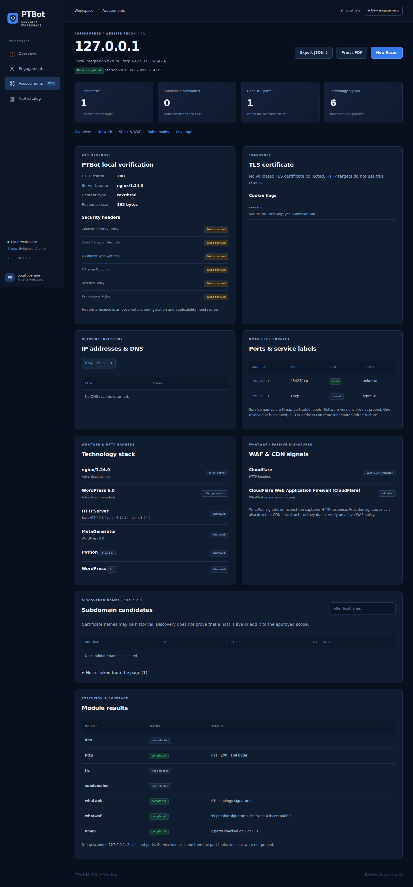

# PTBot 3.6.7

**PTBot** is a local security assessment workspace built with Python, Flask and SQLite by Peleg Elbaz. It organizes authorized engagements, applies target scope and action policies, runs focused checks, and presents evidence in a web dashboard.

This version includes **Assessments**, with Website Recon, a focused XSS check and the existing Workbench. It is designed to run locally on **Ubuntu**. The supplied installation scripts also target Kali Linux and Debian.



## What Website Recon collects

- IP addresses and DNS A/AAAA, CNAME, MX, NS and TXT records.
- Subdomain candidates from public Certificate Transparency data, TLS names and HTML links, with provenance and scope labels. Candidates are not automatically tested.
- HTTP status, page title, server banner, selected security header presence and cookie attributes; cookie values are discarded.
- TLS certificate issuer, expiration, protocol and subject alternative names for HTTPS targets.
- Technology indicators using WhatWeb level 1 through a scoped loopback HTTP gateway.
- Passive WhatWaf signatures against the already captured HTTP response. The WhatWaf command-line scanner and active bypass routines are not run.
- Nmap TCP connect checks on up to 16 selected ports on the first resolved IP. Service labels come from the port-name table; this workflow does not probe service versions.
- Module progress, cancellation, history, JSON export and browser print/PDF.

PTBot 3.6.7 was built from the available 3.5.4 source archive. Intermediate revisions that were not supplied are not incorporated.

## Ubuntu prerequisites and tools

Use an Ubuntu system with `sudo` access and a working internet connection for first-time installation. Install Python, virtual environment support, pip and Git:

```bash
sudo apt-get update
sudo apt-get install -y python3 python3-venv python3-pip git
```

The project uses the following tools:

| Component | Purpose | Installation |
| --- | --- | --- |
| Python 3 and pip | Application and dependencies | Ubuntu commands above |
| Flask, Waitress, Requests, dnspython | Web UI, local server, HTTP and DNS features | `bash install.sh` installs the pinned Python requirements |
| Nmap | Selected TCP port checks | `bash install-recon.sh --whatwaf` installs it through apt |
| WhatWeb | Web technology signatures | The recon installer installs it through apt |
| WhatWaf source | Passive response signature checks | The recon installer downloads a pinned revision with Git |
| Chromium and Playwright | Optional browser execution verification for the XSS module | `bash install-browser.sh` |

The WhatWaf installer needs access to its GitHub repository. It checks out revision `06c815ac541c9bba5c1a0f43ad8abfd44d6abcde`, reads upstream signature functions, and does not install the unrelated WhatWaf CLI dependencies. The website inventory can run without Chromium. Missing optional components are displayed in Tool readiness and module results.

## Install and start on Ubuntu

Extract the ZIP into a **new folder** and open a terminal inside `PTBot-3.6.7`. Run:

```bash
bash install.sh
bash install-recon.sh --whatwaf
.venv/bin/python manage.py init
.venv/bin/python manage.py user
bash start.sh
```

`install.sh` creates `.venv`, installs the versions in `requirements-lock.txt`, and runs the local unit tests. `manage.py user` asks you to create an operator username and a password of at least 12 characters. The application then serves at **http://127.0.0.1:5000** and is bound to loopback by `serve.py`; open it on the same machine.

To enable the optional browser verification used by the XSS module:

```bash
bash install-browser.sh
```

If you only want to inspect the local interface first, you can omit the recon or browser installers; their dependent modules will report missing tools. `setup.sh` provides a separate setup path that installs the browser and creates demo data, but it does not install the recon tools.

## Configure an authorized engagement

1. Create an engagement and enter the intended targets in its included scope. Add exclusions where appropriate.
2. Select the actions the engagement permits. Existing approved engagements do not automatically receive new permissions.
3. Review and approve the engagement.
4. Open **Assessments → Website Recon**, enter an approved URL, select modules and ports, and start the assessment.

| Module | Required policy | Budget unit |
| --- | --- | --- |
| DNS and hostname resolution | `dns_lookup` | One DNS record-type lookup |
| HTTP overview | `http_request` | One HTTP GET |
| TLS | `tls_inspect` and DNS for hostnames | One TLS handshake |
| WhatWeb | `technology_fingerprint` and DNS for hostnames | Each forwarded HTTP GET; at most two per tool run |
| WhatWaf signatures | Successful HTTP overview | Offline analysis; no additional target request |
| Nmap | `port_scan` and DNS for hostnames | One selected-port TCP check |
| CT subdomains | `subdomain_discovery` | One query to the fixed crt.sh service |

For a site under `www.example.com`, use `example.com` as the **Subdomain base** to look for sibling names. The base also needs its own approved domain scope. A wildcard covers subdomains, not the apex. URL-only scope remains limited by scheme, port and path. Nmap requires host-wide scope and refuses a hostname with path exclusions. A hostname needs both a domain scope and a DNS grant before resolution.

Private lab networks require `AI_PT_ALLOW_PRIVATE=1`; link-local, multicast and unspecified addresses are blocked. For a local lab, approve the relevant URL and IP rules separately when HTTP and port checks are both needed.

## Example: TryHackMe Vulnversity lab

An authorized lab run on 27 September 2026 targeted `http://10.81.173.125:3333/`. The exported result recorded HTTP 200, the title `Vuln University`, an `Apache/2.4.41 (Ubuntu)` server indicator, and WhatWeb indicators including Bootstrap and jQuery. Of four selected TCP ports, 21, 22 and 3333 were open, while 80 was closed.

The result also noted several security headers absent from the sampled HTTP response and labeled linked external domains as out of scope. Those are observations for review, **not confirmed vulnerabilities**. The Nmap output did not probe service versions; names such as `ftp`, `ssh` and `dec-notes` were port-table labels. No WAF identification in this result does not establish that no WAF exists. TLS and subdomain discovery were skipped because the target was an IP address over HTTP. The lab address is temporary and should not be treated as a permanent example target.

## Architecture and data

The Flask application and engagement UI define the workflow. `scope_engine.py` evaluates included and excluded target rules; `policy_engine.py` checks the permitted action. `recon_engine.py`, `recon_tools.py` and `recon_ui.py` coordinate the recon job, tool adapters and views. Store modules persist records in SQLite. Tests in `tests/` cover the engines and application behavior. This is a scoped assessment workspace; it is **not an autonomous AI exploitation agent**.

Code and data are separate. The default database name remains `data/ptbot-3.5.4.db` for compatibility even though the application version is 3.6.7. `PTBOT_DATA_DIR` or `AI_PT_DB_PATH` can override the data location. The recon migration adds a table without removing existing engagement and evidence data.

To transfer an existing 3.5.4 database into a new folder, stop the old server and run the copy **before** initializing the new one:

```bash
.venv/bin/python scripts/copy_database.py /absolute/path/to/old/PTBot-3.5.4/data/ptbot-3.5.4.db data/ptbot-3.5.4.db
.venv/bin/python manage.py init
```

The helper uses SQLite backup and refuses an existing destination. Create a new operator with `manage.py user`, or privately copy your existing `instance/operator.json`. Keep the previous folder as a rollback copy.

## Tool settings and limits

- `PTBOT_NMAP_BIN`: absolute Nmap executable path if it is not on `PATH`.
- `PTBOT_WHATWEB_BIN`: absolute WhatWeb executable path if it is not on `PATH`.
- `PTBOT_WHATWAF_DIR`: WhatWaf source directory containing `lib/settings.py` and `content/plugins`; default `tools/WhatWaf`.

Tool processes have time and output bounds and are stopped on cancellation or revocation. HTTP connects to validated addresses with TLS hostname verification. Redirects are displayed but not followed. WhatWeb traffic passes through a temporary loopback gateway, so URL-specific fingerprints may be missed. WhatWaf and CDN signatures are indicators, not proof of active protection or a vulnerability.

Recon preserves partial results when a later module fails and records incomplete coverage. Restarts mark pending recon jobs interrupted. In-flight socket operations can take until their timeout to stop. One seed URL and one resolved address are used for the main connections. There is no crawler, CT candidate reachability scan, Nmap service-version probe or active WhatWaf bypass routine.

## Tests and publishing

Run the bundled offline tests with:

```bash
.venv/bin/python -m unittest discover -s tests -v
```

See `docs/TEST_RESULTS.txt`, `docs/RECON_HE.md`, and `docs/RELEASE_NOTES.md` for more details. Before publishing a repository, review source and screenshots and keep `data/*.db`, backups, `instance/`, credentials, `.env` files, logs, captures, reports and raw assessment exports private. The included `.gitignore` covers common local paths, but previously tracked files require a separate Git history review. Only test systems that you are authorized to assess.

## References

- [Nmap documentation](https://nmap.org/docs.html)
- [WhatWeb](https://github.com/urbanadventurer/WhatWeb)
- [WhatWaf](https://github.com/Ekultek/WhatWaf)
- [Certificate Transparency search](https://crt.sh/)
